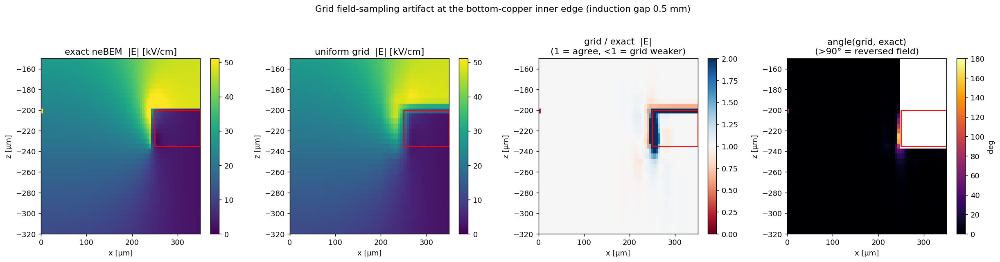
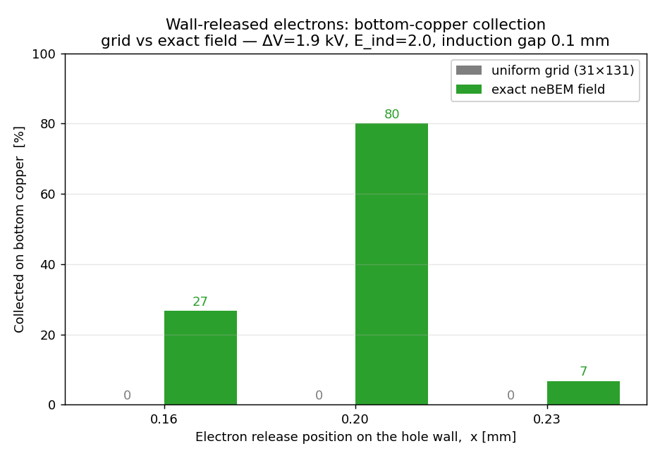
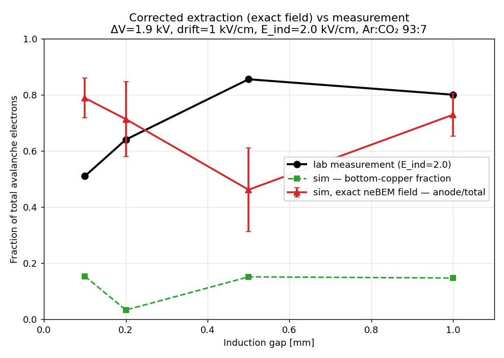
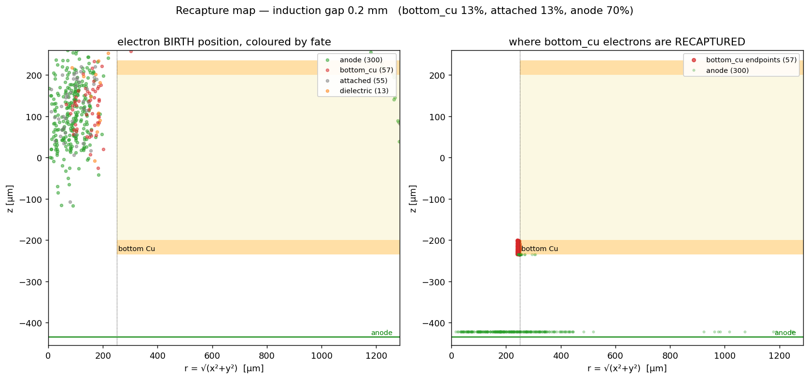
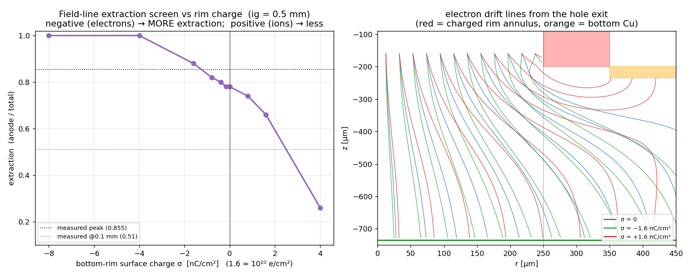

# Investigation: Anode/THGEM-top charge ratio vs induction gap

**Status:** root cause of the simulated over-extraction **identified and fixed** — it was a
*field-sampling artifact* of the uniform transport grid at the thin copper edge, not physics.
On the exact (neBEM) transport field the simulation finally collects charge on the bottom
copper and the extraction magnitude drops into the measured band. One feature of the
measurement — the **suppression of the ratio at small induction gaps** — has no counterpart in
the idealized electrostatic + microscopic model; the **leading candidate is bottom-rim
dielectric charging-up** (§10–11), which a field-line screen shows moves extraction the right
way for the measured sign, magnitude and E_ind-independence, with the gap-dependence still open.

This note records the full investigation into reproducing, in the Garfield++ THGEM simulation,
a lab measurement of the **Anode/THGEM-top charge ratio as a function of the induction gap**.
It documents every hypothesis tested, why each was rejected, the tooling added along the way,
the grid artifact that turned out to be the real cause of the sim's over-extraction (a reusable
finding for any thin-electrode THGEM simulation), and the one measured feature that is still
unexplained.

---

## 1. The measurement and the target

The reference data (`charge_ratio.pdf`) were taken at **ΔV_THGEM = 1.9 kV, drift field = 1 kV/cm,
Ar:CO₂ 93:7**, for three induction fields E_ind ∈ {1.5, 2.0, 2.5} kV/cm, sweeping the induction gap
from 0.1 to 2.0 mm. The observable is the **Anode / THGEM-top charge ratio**.

Characteristic shape (E_ind = 2.0 kV/cm):

| induction gap [mm] | 0.1 | 0.2 | 0.5 | 1.0 | 2.0 |
|---|---|---|---|---|---|
| Anode/THGEM-top | 0.51 | 0.64 | **0.855** (peak) | 0.80 | 0.755 |

Two features drive the whole investigation:

1. A **rise to a peak at ~0.5 mm, then a gentle fall** — i.e. the ratio is *lowest at the smallest
   induction gap*.
2. The three E_ind curves **coincide at 0.1 and 0.2 mm** and separate only for gaps ≥ 0.5 mm. So the
   small-gap suppression is **independent of the induction field**.

## 2. The observable in the simulation

Following the interpretation used here, the measurement's denominator ("THGEM-top charge") is taken
to represent the **total avalanche charge**, so the ratio is compared to the simulated
**electron-collection fraction**

```
frac_anode = (electrons collected on the anode) / (total electrons produced in the avalanche)
```

classified from the avalanche electron endpoints (anode / THGEM bottom copper / top copper /
dielectric / attached), with no induced-signal weighting. At ΔV = 1.9 kV the ions are not drifted
(electrons only), consistent with a collection-fraction observable.

## 3. Study 1 — static extraction geometry (hole rim + transport grid)

**Hypothesis.** The default geometry has no rim (copper flush with the dielectric hole) and a
coarse transport grid, so the simulation *over-extracts*: nearly every avalanche electron reaches
the anode and almost none land on the bottom copper. A real THGEM has the copper etched back from
the hole edge (a ~0.1 mm rim), which should reduce extraction and add bottom-copper collection.

**Tool added — `collect_only` mode** (commit `44cecd1`). The collection fraction classifies
electron *endpoints* and never uses the Shockley–Ramo weighting fields, so a new
`simulation.collect_only` flag (implied by `drift_only`) skips weighting-field sampling, the
read-out electrodes, the induced-signal/charge/amplifier block and the weighting-map dump, keeping
only the transport field, drift area and the collection tally. Field sampling then needs one field
instead of four (**~4× faster**), which makes a finer hole-vicinity transport grid tractable. The
default avalanche path (induced charge) is unchanged.

**Method.** Avalanche collection sweep at ΔV = 1.9 kV, drift = 1 kV/cm, E_ind = 2.0 kV/cm,
Ar:CO₂ 93:7, induction gaps {0.1, 0.2, 0.5, 1.0, 2.0} mm, with **rim = 0.1 mm** and a refined
transport grid (**51 × 161**, ~20 µm lateral — ~5 points across the 100 µm rim). The collection
fraction is cap-independent without space charge, so a modest avalanche cap (500 e⁻) was used.

**Result.**

| induction gap [mm] | 0.1 | 0.2 | 0.5 | 1.0 | 2.0 |
|---|---|---|---|---|---|
| measurement | 0.51 | 0.64 | 0.855 | 0.80 | 0.755 |
| sim, rim = 0 | 0.95 | 0.92 | 0.91 | 0.90 | 0.89 |
| sim, rim = 0.1 mm | 0.95 | 0.89 | 0.71 | 0.50 | 0.48 |
| sim bottom-Cu, rim = 0.1 mm | 0.00 | 0.00 | 0.01 | 0.02 | 0.02 |


**Conclusion.** The rim changes the magnitude and adds a slope, but the slope is a **monotonic fall**
(0.95 → 0.48), the *opposite* of the measured rise at small gaps. Two things stood out and only
later made sense: the simulation is most anode-efficient (0.95) exactly where the measurement is
least (0.51), and the **bottom-copper collection stays ~0–2 % at every gap** even with a 0.1 mm rim.
That second fact — essentially *no* electron ever lands on the bottom copper — is physically wrong
for a biased THGEM (the user measures real charge there with a charge amplifier), and it turned out
to be the signature of the grid artifact of §7, not a property of the geometry.

## 4. Study 2 — single-avalanche space charge

**Motivation.** The measured rise-to-peak requires a mechanism whose strength *changes with the
induction gap*. Space charge at the real gain is the natural candidate: a dense avalanche confined
near the hole exit could suppress extraction most at small gaps (small volume → high density) and
relax as the gap opens. `AvalancheMicroscopic` has no space charge, so it is absent from the
simulation.

**Key constraint (from the measurement conditions).** The data were taken at a **very low rate,
~10 Hz**. Ion transit is µs–ms, so no ion cloud accumulates between events — any space-charge
effect must be the **self-field of a single avalanche** acting on its own electrons, not a
steady/accumulated cloud.

**Method (Stage 1 estimate).** Rather than a hand-drawn charge blob, the estimate uses the
**simulated avalanche's actual charge geometry** (ionization sites = ion birth positions, and
electron drift-line points, from the rim = 0 sweep), scales the total charge to a real
single-avalanche gain G, and Coulomb-sums the retarding axial field E_sc,z that an electron feels
at the hole exit. It is compared to E_ind = 2 kV/cm. (The avalanche's lateral RMS radius is
~120–130 µm at both 0.1 and 1.0 mm gaps.)

**Result — E_sc / E_ind at the hole exit (ion + electron contributions):**

| gain G | 10³ | 10⁴ | 10⁵ | 10⁶ | 10⁷ |
|---|---|---|---|---|---|
| ig = 0.1 mm | 0.0002 | 0.003 | 0.03 | 0.31 | ~3 |
| ig = 1.0 mm | 0.0002 | 0.002 | 0.02 | 0.23 | ~2 |
| upper bound* | 0.001 | 0.005 | 0.05 | 0.50 | ~5 |

\*all G·e compressed into a sphere of the observed 120 µm column radius — a hard ceiling.


**Verdict — ruled out**, for three independent reasons:

1. **Magnitude.** At this THGEM's realistic single-avalanche gain (10³–10⁴ at ΔV = 1.9 kV, kept
   modest by discharge-safe, low-rate operation), the self-field is **0.02–0.3 % of E_ind** — three
   orders of magnitude too small. Even at an optimistic 10⁵ it is ~2 %, and the hard upper bound
   stays below E_ind until G ≳ 10⁶ (streamer regime).
2. **No gap dependence.** The ions sit in the hole, so the field is essentially identical at 0.1 and
   1.0 mm. The measurement's whole signature is a strong gap dependence.
3. **The real bar is higher.** The hole-exit field also includes the THGEM dipole leakage (≫ E_ind),
   so the field the self-charge must compete with is larger still.

The planned Stage 2 (injecting the self-field into the solver) was skipped: adding a ~1 % field
changes nothing.

**Revisited (§13a).** This estimate used a capped avalanche, whose charge sits mid-hole, and reason 2
does not hold for the real one: at small gaps the uncapped avalanche grows its head *in the gap*, half
of its ions within 50 µm of the anode at 0.1 mm. With that geometry, the space charge would push ions
onto the anode above **3–10 pC per event**. The measured charge (< 100 fC per event) keeps the verdict:
ruled out.

## 5. The denominator (ion collection) — ruled out

Both static studies addressed the **numerator** (anode extraction), while the measurement's own
structure — the three E_ind curves coinciding at small gaps — points at the **denominator**. The
"THGEM-top charge" was therefore examined as a possible driver, including an ion contribution to the
top electrode (ion drift off, 300 ns window → ions missing from the induced charge).

This is excluded by a simple bound. With the denominator read as the **total collected charge** (the
user integrates the THGEM-top charge over a few µs with a charge amplifier and is confident it is the
total), the ratio is

```
Anode/THGEM-top = ε / f_top    with ε = extraction efficiency, f_top = fraction landing on THGEM-top ≤ 1,
```

so **Anode/THGEM-top ≥ ε**. No distribution of charge over the top electrode can push the ratio
*below* the extraction efficiency, yet the measurement sits at 0.51 at the smallest gap — a small
number that must come from a genuinely low *numerator*, not a large denominator. Separately, the user
confirmed the bottom electrode collects **electrons** (it shows signal on a charge-sensitive
amplifier), not a drifting ion cloud, so simulating ion collection on the bottom does not address the
discrepancy. The denominator is not the cause.

## 6. Electron attachment — ruled out

Attachment is the only non-anode fate the simulation produced for a long time (see §7 for why), so it
was checked directly. Microscopic attachment comes from the Magboltz cross-sections, not the
macroscopic η table, so `ResetElectronAttachment` does not switch it off; the effective attachment
was varied through the CO₂ fraction instead. Lowering CO₂ (less attachment) simply moved the attached
electrons **to the anode** — `frac_anode` rose 0.86 → 0.92 as attachment fell 0.14 → 0.08 — and left
the bottom-copper fraction at zero. Attachment is a minor, roughly gap-flat loss; it cannot create a
measured ratio below the extraction efficiency, and it does not route electrons to the bottom copper.
Not the cause.

## 7. Root cause — the grid field-sampling artifact at the copper edge

Every study above shared one impossible symptom: **~0 % of avalanche electrons ever land on the
bottom copper**, at any rim size, grid resolution or CO₂ fraction. "Thinking from scratch about what
could stop an electron from ever reaching the bottom electrode" led to the transport field itself.

The simulation transports electrons on a **`ComponentGrid`**: the neBEM field is sampled onto a
**uniform** mesh once (fast per-step trilinear interpolation), instead of querying the exact but slow
`ComponentNeBem3d` at every step. The bottom copper is only **35 µm** thick, and its sharp inner
corner is a **field near-singularity** — the magnitude spikes and the direction rotates by ~90° over
a few µm. A uniform grid (and `SetMesh` is uniform-only) cannot resolve that:

- **Magnitude is smeared.** On a 5 µm dump slice the exact field peaks at **~110 kV/cm**; the sampled
  grid field never exceeds **~51 kV/cm**.
- **Direction reverses in a one-cell skin.** Trilinear interpolation across the metal boundary blends
  in-metal nodes with gas nodes, producing a thin layer — one grid cell wide — hugging the copper
  surface in which the sampled field points **up to ~160° away from the true field**, i.e. back
  toward the hole and the anode. An electron drifting down the copper surface in that skin is pushed
  **off the copper and up to the anode** instead of being collected.



The decisive test releases electrons **directly on the hole wall** (`source.release_z_cm`) and
transports them on the grid vs on the exact neBEM field (`fields.use_raw_nebem`), everything else
identical. On the grid they essentially never reach the bottom copper; on the exact field tens of
percent do.



The artifact is a **resolution/interpolation** failure, not a bug in the geometry or potentials, so
the grid-side fixes do **not** remove it (all tried, all still ~0 % bottom copper):

- **Finer uniform grid** (31 × 131 → 61 × 201): the skin shrinks but never vanishes — the field
  rotates sub-cell at any feasible spacing.
- **Copper-edge chamfer** (`geometry.edge_round_um`): turns the 90° corner into an obtuse,
  grid-resolvable edge, but the thin skin along the remaining copper face persists.
- **Conductor in-painting** (`fields.inpaint_conductors`): fill the in-metal nodes with the
  neighbouring gas field before interpolating — removes the in-metal blend but not the sub-cell
  rotation; the reversed skin remains.

Both options are committed but **opt-in and off by default** (the default keeps the historical `_v2`
transport cache). The correct transport at the edge is **`use_raw_nebem`** — transport directly on
`ComponentNeBem3d`, no interpolation. It is slow (exact field query per step), but with a small
avalanche cap the *collection fraction* is cap-independent, so a handful of events suffices.

## 8. The corrected result and the remaining puzzle

Re-running the induction-gap sweep on the **exact neBEM field** (rim = 0, small cap, few events):



| induction gap [mm] | 0.1 | 0.2 | 0.5 | 1.0 |
|---|---|---|---|---|
| measurement | 0.51 | 0.64 | 0.855 | 0.80 |
| sim anode/total (exact field) | 0.79 | 0.71 | 0.46\* | 0.73 |
| sim bottom-copper fraction | 0.15 | 0.03 | 0.15 | 0.15 |

\*wide statistical error (~6 events; per-point SEM 0.07–0.15).

Two things are fixed. The bottom copper now collects a real fraction (**~15 %**, zero on the grid),
and the extraction magnitude falls from the grid's ~0.9 to **~0.75**, inside the measured band. But
within the statistics the corrected extraction is **flat in the induction gap**, while the
measurement **rises** from 0.51 to 0.855. The idealized model does not contain the small-gap
suppression.

This is not a voltage-convention effect. The simulation holds the fields fixed and lets the electrode
potentials scale with the gap (confirmed to match the measurement's setup):

| induction gap [mm] | 0.1 | 0.2 | 0.5 | 1.0 |
|---|---|---|---|---|
| V_anode [V] | 0 | 0 | 0 | 0 |
| V_bottom-Cu [V] | −20 | −40 | −100 | −200 |
| V_top-Cu [V] | −1920 | −1940 | −2000 | −2100 |
| V_drift [V] | −2020 | −2040 | −2100 | −2200 |

(V_bottom-Cu = −E_ind·d_ind, V_top-Cu = V_bottom-Cu − ΔV_THGEM, V_drift = V_top-Cu − E_drift·d_drift.)
At fixed E_ind the hole-exit extraction field is gap-independent, which is exactly why the static
model gives a flat ratio. The measured rise-then-fall — strongest at small gaps and independent of
E_ind there — must come from something outside a single-avalanche electrostatic + microscopic
transport model (candidates not yet tested: dielectric charging-up at the hole wall, or a readout/
charge-definition effect in the denominator at small gaps). That is the open question.

## 9. Where the recaptured electrons go — a sharp-corner effect

A higher-statistics exact-field sweep (`use_raw_nebem`, 40 events/gap vs the ~6 of §8) sharpens the
numbers and adds a per-electron **recapture dump** (`simulation.dump_collection`, writing each
electron's birth, endpoint and fate to `collection_endpoints.csv`):

| induction gap [mm] | 0.1 | 0.2 |
|---|---|---|
| measurement | 0.51 | 0.64 |
| sim anode/total | 0.757 ± 0.048 | 0.653 ± 0.044 |
| sim bottom-copper | 0.052 ± 0.013 | 0.133 ± 0.029 |
| sim attached | 0.11 | 0.13 |

With real error bars the simulated extraction **decreases** with gap (0.757 → 0.653) while the
measurement **rises** (0.51 → 0.64): the two cross near 0.2 mm, and at the smallest gap the idealized
sim *over*-extracts (0.76 vs 0.51). (Each larger gap is a multi-hour raw-neBEM run, so the
high-statistics sweep was not pushed past 0.2 mm.)

The dump shows **where** the bottom-copper electrons are lost: every one ends at the **sharp inner
corner of the bottom copper** (r ≈ 243 µm, z ≈ −220 µm — a few-µm-tight cluster), although they are
*born throughout the hole*, in the same region as the extracted electrons. Recapture is a near-exit,
near-singular-edge effect, not a birth-position effect — which turns attention to the exposed
dielectric **rim** at the hole exit.



## 10. Hypothesis: bottom-rim dielectric charging-up

The measured small-gap suppression is **E_ind-independent** (the 1.5/2.0/2.5 kV/cm curves coincide at
≤ 0.2 mm) and absent from the idealized model. A field perturbation **set by charge and geometry, not
by the applied voltage** is the natural candidate — i.e. **charging-up** of the exposed dielectric.

**Literature.** Charging-up is a documented, dominant driver of THGEM gain evolution, and it is
**rim-specific**: Pitt et al. (JINST 13 (2018) P03009) separate a short timescale (hole walls + bottom
rim) from a long one (top rim). Correia & Azevedo (JINST 9 (2014) P07025; 13 (2018) P01015)
established the iterative / superposition method (E_tot = E_uncharged + E_charges over pre-computed
slice fields), whose characteristic charge Q_tot is "set by electrode geometry, not by voltage." The
neBEM authors' own group models it self-consistently in Garfield++-neBEM (Bhattacharya, Dutta,
Mukhopadhyay et al.; arXiv:2112.12471 / 2606.24154; JINST 20 (2025) C04019; MPGD2026).

**The sign — from the self-consistent simulation.** The naive view (electrons drift down → bottom rim
negative) is wrong. In the SINP self-consistent runs the **bottom rim is net *positive*** ("accumulates
both, but is more positive throughout"): it faces the induction gap, and the **returning induction-gap
ions** land on it within tens of ns ("ions made at the hole exit are already beside it"), collecting
+2–5 pC, while the fast electrons are swept out in ~100 ns. The bottom rim is the surface that does the
gain-stabilising, and by intercepting those returning ions it even keeps the lower hole wall negative.
So the surface facing the electrons at the hole mouth carries a **positive** trapped charge.

**neBEM note.** neBEM *implements* a charged-dielectric interface (`DielectricCharge`, type 5; exposed
here via a `ChargedDielectricHole`/`ChargedDielectricTube` + `fields.dielectric_surface_charge`), but
it **rejects a charged dielectric that touches a conductor** — and the foil is clamped between the two
copper layers, while decomposing it to isolate the exposed-rim annulus produces coincident panels that
neBEM's overlap handling also rejects. So the charge field is added by **superposition** (the Correia
method, done analytically), not solved as a boundary condition.

## 11. Field-line extraction screen

A full charged-field avalanche sweep is many days of raw-neBEM, so the hypothesis is screened cheaply:
superpose the charge field on the uncharged exact field and **trace electron drift lines** from the
hole exit to termination (`scripts/screen_rim_charge.py`), E_tot = E_uncharged(neBEM) + σ ×
E_annulus(Coulomb) for a charged exposed-rim surface. This is a geometric screen — no diffusion, so
its *absolute* extraction sits above the avalanche value, but the *σ-effect and its sign* are reliable.

**The sign (ig = 0.5 mm):**



| σ [nC/cm²] | −8 | −1.6 | 0 | +1.6 | +4 |
|---|---|---|---|---|---|
| extraction (anode/total) | 1.00 | 0.88 | 0.78 | 0.66 | 0.26 |

A **positive** rim charge **suppresses** extraction (it pulls exiting electrons outward onto the bottom
copper); a negative one enhances it. Combined with §10 — the bottom rim is **positive** — this is the
**right direction**: bottom-rim charging lowers Anode/THGEM-top, as measured. Magnitude is consistent:
the SINP +5 pC over the 100 µm rim annulus is σ ≈ +2.7 nC/cm², which in the screen lands extraction
near **0.5** ≈ the measured 0.51; and a geometry-set charge gives the observed **E_ind-independence**.

**The gap-dependence is still open.** At a *fixed* σ the screened extraction falls monotonically with
gap (σ = +2.7 nC/cm²: 0.84 / 0.68 / 0.48 / 0.38 at 0.1 / 0.2 / 0.5 / 1.0 mm) — the per-charge
suppression is *weakest* at the smallest gap, the opposite of the measured rise-to-a-peak. Matching the
measurement requires the **equilibrium rim charge to grow strongly at small gaps** (plausible — at a
small induction gap the exit ions are collected onto the rim more efficiently — but not shown by the
screen). Settling it needs the **self-consistent charging calculation** (σ set by the physics per gap),
not an imposed σ. Caveats: the superposition is a bare-charge field (ignores the dielectric's
polarization and copper image charges — these rescale the magnitude by a factor of order (1+ε)/2 and
screening, not the sign), and the SINP dynamics run at ~10⁵× the measurement's ~10 Hz rate (the
charge *pattern* carries over, the absolute magnitude does not).

**Status:** sign and mechanism reconciled — a positive bottom rim suppresses extraction, matching the
direction, rough magnitude and E_ind-independence of the measurement; the gap-dependence hinges on
σ(induction gap), the next step.

## 12. Uncapped avalanches on the exact field: mean-avalanche transport (σ = 0)

**Why a new method.** At ΔV = 1.9 kV the gain is ~10⁵ (uncapped grid avalanches: 2.6–4.4 × 10⁴⁺
electrons per event). One cap-50 *microscopic* avalanche on the exact field takes **41 min** on one core,
so an uncapped one is ~14 h — and capping is not harmless: the tracked electrons are the *early* ones,
born mid-hole (mean z ≈ +25 µm), while the ions that charge the bottom rim are born at the exit
(z ≈ −200 µm). §8–9's extraction numbers were capped (cap 10–50) and should be read with that bias.

**Method** (`simulation.mc_electron_transport` + `mc_weighted_paths`). The mean of a branching
drift-diffusion avalanche (independent electrons, local Townsend α and attachment η, absorbing walls) is
given *exactly* by single non-branching paths weighted by G = ∫(α − η)·v_d dt (Feynman–Kac). Each event
is one `AvalancheMC` path (`mc_step_um` = 4): its end carries e^G electrons, the ion births along it
α·v_d·dt·e^G (sampled at `mc_ion_samples` points, dump species `b`), attachment η·v_d·dt·e^G. The ions are
traced along +E on the exact-field slice (they diffuse ~100× less than electrons). Cost: ~5 s per path,
i.e. one drift line instead of 10⁴–10⁵. Fractions are pooled ratios Σw_cat/Σw_total with bootstrap
intervals (`scripts/meanaval_rim.py`).

**Bugs found on the way** (all fixed; the default microscopic path is byte-identical):

| | Bug | Effect | Fix |
|---|---|---|---|
| 1 | Gas tables declare no α/η threshold (`Thresholds: 1 1 1`), so Garfield's quadratic interpolation crosses the α = 0 step | α ~10³× too high at 12–23 kV/cm, η ~10²× near 3 kV/cm — every `AvalancheMC` electron (microscopic tracking uses cross sections, unaffected) | linear log–log interpolation for α, η (`SetupGas`) |
| 2 | neBEM tiles the *field* over the lattice but the *solids* exist only in the central cell | a charge funnelled into a neighbouring hole met no walls; inside the plate it drifted through "gas" in a neighbour's FR4/copper (runaway gain, endpoints stuck at the cell edge — also in the earlier raw-field microscopic runs) | `PeriodicNeBem3d` folds (x, y) into the cell for the medium lookup; classifiers use the folded radius |
| 3 | Surface classifier | time-window electrons counted as deposited; copper tested against the circle, not the 12-gon inradius (copper-flat hits tallied as rim); hits a hair below the copper face tallied as anode | unresolved category; inradius rCu·cos(π/12); 1 µm tolerance |
| 4 | Raw-neBEM field at a point ~10⁻⁸ cm from a panel (a path's terminal point) is singular | α extrapolated far beyond the table, one path's G ≈ 360 | terminal point reuses the previous rates; \|E\| for α/η clamped at the table maximum |

**Result at σ = 0** (2 × 500 paths per gap; on the raw field the transport now runs down to the
anode plane, see §13a — the 0.1/0.2 mm runs were redone with it, the earlier ones are kept in
`meanaval_sigma0_inset/`):

| induction gap [mm] | 0.1 | 0.2 | 0.5 | 1.0 |
|---|---|---|---|---|
| measurement | 0.51 | 0.64 | 0.855 | 0.80 |
| sim extraction (anode/total) | 0.977 [0.971, 0.984] | 0.859 [0.817, 0.903] | 0.62 [0.55, 0.72] | 0.37 [0.32, 0.45] |
| electrons → bottom copper | 0.006 | 0.077 | 0.29 | 0.51 |
| ions → bottom rim (per aval. e⁻) | 0.021 | 0.096 | 0.23 | 0.22 |
| electrons → bottom rim | 0.001 | 0.013 | 0.010 | 0.041 |
| **net rim charge** (ions − e⁻) | **+0.020** [0.011, 0.030] | **+0.083** [0.036, 0.123] | **+0.22** [0.12, 0.30] | **+0.18** [0.08, 0.26] |

1. **The rim charges positive at every gap**, ion-dominated, the sign of the SINP self-consistent
   simulations (§10) and the sign that suppresses extraction (§11).
2. **The uncharged extraction falls with gap**, the opposite of the measurement, through electrons
   ending on the bottom copper's lower face. That loss is concentrated in **corner-wrapping paths**: at
   1.0 mm, 11.5 % of the paths end on the bottom copper, but with a median G of 13.8 against 11.8 for
   anode paths (~8× more gain each), they carry 54 % of all avalanche electrons. Counting paths alone,
   the extraction would be ≈ 0.99 / 0.99 / 0.95 / 0.88.
3. **The same corner avalanches make the ions that charge the rim** (one path in 300 carried half the
   ion-rim weight in a validation set): the near-singular field at the sharp bottom-copper inner corner
   multiplies electrons right beside the recessed rim.

**Caveat: heavy tails.** The weights are heavy-tailed (effective sample size 31–126 of 1000 paths; the
two seeds at 0.5/1.0 mm differ beyond their errors), so magnitudes at large gaps carry wide intervals.

**Check against microscopic transport.** The corner gain above is computed in the local-field
approximation, which is suspect where the field changes over ~µm. To test it, primaries were released
inside the hole near the exit (`source.release_z_cm`, `release_r_max_cm` = 240 µm; ig = 0.5 mm, exact
field) and transported both ways, weighted mean avalanche vs full microscopic avalanches
(`scripts/meanaval_validate.py`), binned by release radius:

| release | r [µm] | electrons per primary, weighted → microscopic | → bottom copper, weighted → microscopic | → anode, weighted → microscopic |
|---|---|---|---|---|
| z = −190 µm (1500 / 130 primaries) | 0–120 | 3.8 → 6.2 ± 1.1 | 0 → 0 | 0.89 → 0.83 |
| | 120–200 | 5.1 → 8.0 ± 0.8 | 0.11 ± 0.02 → 0.07 ± 0.03 | 0.80 → 0.82 |
| | 200–245 | 10.8 ± 1.2 → 23.6 ± 5.4 | 0.50 ± 0.11 → 0.65 ± 0.23 | 0.44 → 0.32 ± 0.03 |
| z = −150 µm (300 / 48 primaries) | 0–120 | 7.7 → 14.9 ± 3.7 | 0 → 0 | 0.89 → 0.87 |
| | 120–200 | 13.9 ± 1.7 → 21.4 ± 3.2 | 0.31 ± 0.13 → 0.07 ± 0.02 | 0.61 → 0.83 |
| | 200–245 | 23 ± 9 → 16 ± 7 | 0.67 ± 0.38 → 0.50 ± 0.32 | 0.27 → 0.40 ± 0.16 |

1. **Microscopic gain is 1.5–2× higher** in every central bin of both tests. The 10-point gas table
   with log–log interpolation underestimates α between its points. Absolute gains from the weighted
   mode are therefore low; fractions are less affected, because every path crosses the same interior.
2. **The corner loss agrees within errors.** For near-wall releases, where electrons wrap the copper
   corner, microscopic tracking sends 50–65 % of the avalanche to the bottom copper, against 50–67 %
   weighted. The z = −150 µm mid-radius 0.31 is a heavy-tail fluctuation: the same bin at z = −190 µm,
   with 650 paths, gives 0.11 against microscopic 0.07.
3. So there is **no evidence that the local-field model overstates the corner loss**. The falling
   uncharged extraction vs gap is a property of the modelled geometry at this gain, not a transport
   artifact; microscopic gain, if anything, makes the corner avalanches heavier.

**Open question: the corner shape.** The effect lives in the near-singular field of a *perfectly sharp*
bottom-copper inner corner (r = rCu, z = −235 µm). A real etched copper edge is rounded, and the corner
gain is sensitive to its radius, so the result should be tested against corner rounding before it is
trusted. The existing `geometry.edge_round_um` widens only the copper's dielectric-side face, not this
lower corner. Rim charging alone is unlikely to restore the measured trend: its net deposit is largest
at large gaps (+0.22, +0.18), exactly where the uncharged extraction is already too low, and a positive
rim suppresses extraction further (§11).

**Next: the self-consistent equilibrium.** neBEM carries the SINP charging-up machinery
(`ComponentNeBem3d::SetChargingUpOptions(1)` with `neBEMInp/neBEMChargingUp.inp`). Electron and ion
endpoints are mapped onto the dielectric elements and enter the solve as free charge (`RHVector`, case 4),
including copper and anode images and FR4 polarisation. It avoids the charged-dielectric/conductor
rejection of §10 and captures the gap-dependent anode image the §11 free-space screen cannot. Iterating
deposit → re-solve → re-transport until the net rim deposition vanishes gives the infinite-leakage
equilibrium per gap. Planned order: first the corner-rounding test, then this equilibrium on the
surviving geometry.

## 13. Are avalanche ions collected on the anode at small gaps?

**Hypothesis.** Positive ions physically landing on the anode would cancel part of the electron
charge it collects and lower the numerator, if it happened preferentially at small gaps.

**Without charging, no.** The anode (0 V) is the most positive electrode and positive ions only move
toward lower potential. Of 3000 weight-sampled ion births per gap from the §12 mean avalanche, **none**
field-line onto the anode at any gap. The hole exit sits 200–470 V *below* the anode (table below), so
the ions are pulled up into the hole.

**With a charged rim.** A positive bottom-rim charge raises the local potential. At fixed E_ind the
bottom copper is only −E_ind·d below the anode (−20 V at 0.1 mm, −200 V at 1.0 mm), so a free-space
estimate (tens of volts per nC/cm²) suggested the exit could rise above the anode at small gaps. The
anode is then only 0.1 mm away, so its image charge must be included. The field is therefore computed with
**neBEM's charging-up** (`fields.charging_up`): `scripts/rim_charge_files.py` writes 6000 synthetic ion
deposits spread uniformly over the bottom rim as charging-up endpoint lines. neBEM maps every one onto a
dielectric element (checked in `PtIChUpMap.out`) and solves with the copper and anode images and the FR4
polarisation.
- **Linear superposition:** the problem is linear, so one solve per gap at +1 nC/cm² gives
  E(σ) = E₀ + σ·(E₁ − E₀). Doubling the charge doubles the change, to 10⁻⁵.
- **Potential offset:** neBEM adds a uniform, field-free potential offset for the net charge, so only
  potential differences are used.
- **Ion tracing:** `scripts/rim_ions_to_anode.py` traces the §12 ion births on E(σ).

| induction gap [mm] | 0.1 | 0.2 | 0.5 | 1.0 |
|---|---|---|---|---|
| rim recess − anode potential, σ = 0 | −203 V | −263 V | −365 V | −474 V |
| rise per +1 nC/cm² (relative to the anode) | **+1.4 V** | +4.7 V | +23 V | +66 V |
| ions on the anode, σ = 2.7 nC/cm² (SINP scale) | 0 | 0 | 0 | 0 |
| ions on the anode, σ = 20 nC/cm² | 0 | 0 | 0 | 0.2 % |
| ions on the anode, σ = 50 nC/cm² | **0.07 %** | **0** | 8 % | 26 % |
| ions on the bottom rim, σ = 0 → 50 nC/cm² | 2.3 → 0.07 % | 8.9 → 2.5 % | 22 → 1.5 % | 23 → 0 % |

**Verdict: excluded, and the gap dependence runs the wrong way.** At small gaps the nearby anode (plus
the copper 35 µm from the rim) **screens** the rim charge almost completely, at only +1.4 V per nC/cm²
at 0.1 mm. Lifting the exit above the anode would take ~150 nC/cm², about 50× the SINP-scale charge;
even at 50 nC/cm² essentially no ion reaches the anode at 0.1 or 0.2 mm. Ions can be pushed onto the
anode only at **large** gaps, and only for charges ≳ 20–50 nC/cm², the opposite of the measured
small-gap suppression.

The scan also shows the **self-limiting feedback** the equilibrium calculation needs: a positive rim
repels further ions (the rim's ion share falls with σ at every gap).

Caveats: ion births are taken from the uncharged avalanche, the test charge is uniform rather than the
equilibrium pattern, and ion diffusion (~100× below the electrons') is neglected. None of these can
bridge a ~50× gap at 0.1 mm.

### 13a. The avalanche head grows in the gap

At small gaps the hole's field leaks straight through to the anode: under the hole the gap field is
19.6 kV/cm at 0.1 mm (15.3 at 0.2 mm), not the nominal 2 kV/cm. The gap therefore multiplies, and the
**avalanche head sits on the anode**:

| induction gap [mm] | 0.1 | 0.2 | 0.5 | 1.0 |
|---|---|---|---|---|
| ions born in the gap | **83 %** | 69 % | 65 % | 63 % |
| … within 50 µm of the anode | **48 %** | 4.7 % | 0 | 0 |
| … within 12 µm of the anode | 16 % | 0.8 % | 0 | 0 |
| field under the hole, gap middle | 19.6 kV/cm | 15.3 kV/cm | 7.9 kV/cm | 3.7 kV/cm |

Two consequences were checked:

1. **The last 12 µm had been cut.** The drift area was inset by one transport-grid cell above the
   anode (an anode-slide fix for the uniform grid) also on the raw field, which needs no such fix.
   Raw-field transport now runs to the anode plane (`SetupSensor`). At 0.1 mm that adds the 16 % of
   ions born in the last 12 µm; the extraction and net rim charge change within their errors (§12).
2. **Ions born at the anode still leave it.** The anode is the most positive electrode, so the field
   at its surface points away from it everywhere; of 338 sampled ions born in the last 12 µm at 0.1 mm,
   all drift up into the hole (one lands on the rim). Thermal diffusion lets an ion climb only
   kT/e = 25 mV, about 14 nm against 18 kV/cm.

**Space charge of the head.** The one way ions could physically be pushed onto the anode is the ion
cloud's own field: below a positive cloud it points down, and the anode's image doubles it.
`scripts/gap_ion_spacecharge.py` freezes the cloud at the σ = 0 ion births (all of an event's charge
in one hole, the worst case), adds its Coulomb field and the anode-plane image to the exact field on
the slice, and traces the ions:

| event charge Q | 100 fC | 1 pC | 3 pC | 10 pC | 30 pC |
|---|---|---|---|---|---|
| ions on the anode, 0.1 mm | 0 | 0 | 0 | 32 % | 61 % |
| ions on the anode, 0.2 mm | 0 | 0 | 0 | 9 % | 45 % |
| ions on the anode, 0.5 mm | 0 | 0 | 0 | 0 | 9 % |
| ions on the anode, 1.0 mm | 0 | 0 | 0 | 0 | 0.9 % |

Space charge does favour small gaps, where the cloud sits on the anode, but the threshold is
**3–10 pC per event**. The measured charge is **below ~100 fC per 5.9 keV event**, at least 30× short,
so this route is excluded too (the frozen cloud overstates it: the real one expands as it drifts).

**Open item: the simulated gain is too high.** The weighted mean avalanche gives ~10⁵ per primary
(microscopic transport even more, §12), i.e. ~4 pC per event (227 primaries), against < 100 fC
measured: a ≥ 30× mismatch. Candidates: the hole field (ΔV definition, real hole and rim dimensions),
the Penning transfer probability (r = 0.57 assumed), attachment to impurities (O₂, H₂O), or gain loss
from charging-up in the real detector. It does not affect the electrostatic conclusions above, but it
matters for absolute magnitudes and the avalanche shape.

## 14. Mechanisms tested and excluded

| # | Mechanism | How tested | Verdict |
|---|---|---|---|
| 1 | Hole rim + grid resolution (§3) | rim 0.1 mm, grid 51 × 161 | Sets magnitude but gives a monotonic **fall**, not the rise; its ~0 % bottom-Cu was the §7 artifact |
| 2 | Single-avalanche space charge (§4) | Coulomb self-field from the real avalanche geometry | Ruled out: ~10³× too weak at realistic gain, and gap-independent |
| 3 | Denominator / ion collection (§5) | ratio ≥ extraction-efficiency bound | Ruled out: cannot push the ratio below ε; bottom reads electrons |
| 4 | Electron attachment (§6) | vary CO₂ (microscopic Magboltz) | Ruled out: minor, gap-flat; routes to anode, not bottom copper |
| 5 | **Grid field-sampling artifact at the copper edge (§7)** | raw-neBEM vs grid, field dump, wall-release | **Root cause** of the over-extraction — fixed by `use_raw_nebem` |
| 6 | Copper-edge rounding / conductor in-painting (§7) | `edge_round_um`, `inpaint_conductors` | Do not fix the grid (sub-cell field rotation); kept opt-in, off by default |
| 7 | **Bottom-rim dielectric charging-up (§10–12)** | field-line screen; mean-avalanche deposition at σ = 0 | **Leading candidate** — the rim charges *positive* at every gap (§12), and a positive rim suppresses extraction. The equilibrium σ(gap) is still open (neBEM charging-up, §12) |
| 8 | Local-field approximation overstating the corner gain (§12) | weighted mean avalanche vs microscopic, primaries released at the hole exit | Ruled out within errors: microscopic gives the same corner loss and 1.5–2× *more* gain |
| 9 | Avalanche ions collected on the anode at small gaps (§13) | ion field lines at σ = 0, then on neBEM charged-rim fields (images included) for σ up to 50 nC/cm² | Ruled out: none at σ = 0; the anode screens the rim charge at small gaps, so ions reach it only at gaps ≥ 0.5 mm for σ ≳ 20–50 nC/cm², the opposite trend |
| 10 | Ion space charge of the avalanche head in the gap (§13a; revisits §4) | head-in-gap ion cloud + anode image, ion field lines vs event charge | Ruled out: ions reach the anode only above 3–10 pC per event; measured < 100 fC |
| — | Measured rise at small induction gaps (§8) | exact-field sweep; uncapped mean avalanche (§12) | **Open** — at σ = 0 the extraction *falls* with gap through avalanches wrapping the sharp bottom-copper corner; next test: corner rounding, then the charging equilibrium |

## 15. Reproducing

Simulation outputs live under `results/` (gitignored):

- `results/transparency_induction_avalanche/` — rim = 0 avalanche induction sweep (also carries the
  avalanche charge geometry used by the space-charge estimate).
- `results/transparency_induction_avalanche_rim100/` — rim = 0.1 mm, grid 51 × 161 sweep.
- `results/extraction_edge_field/` — the exact-field (`use_raw_nebem`) gap sweep
  (`raw_nebem_sweep.csv`) and a `dump_raw_field` slice through the copper edge
  (`raw_vs_grid_field_ig0p5.csv`).
- `results/extraction_charging/` — the high-statistics exact-field collection sweep with
  `dump_collection` (`collection_endpoints.csv` per gap, for the recapture map), the
  `dump_raw_field` slices over the full hole-exit → induction gap used by the charge screen and the
  ion tracer (`dump_ig0p1` … `dump_ig1p0`), the σ = 0 mean-avalanche runs (`meanaval_sigma0/`, §12) and
  the weighted-vs-microscopic checks (`corner_test_z190/`, `exit_test_z150/`, each with its
  `comparison.txt`), and the charged-rim fields of §13 (`rimcharge_unit/`: uncharged and +1 nC/cm²
  slices per gap, the +2 nC/cm² linearity run, the neBEM charging-up inputs and element maps, and
  `ions_vs_rim_charge.csv`),
  and the 0.1/0.2 mm σ = 0 runs made before the transport reached the anode plane
  (`meanaval_sigma0_inset/`, §13a).

Figures in this note regenerate from those outputs via:

```bash
python3 scripts/plot_extraction_comparison.py   # -> docs/figures/extraction_meas_vs_sim.png
python3 scripts/plot_spacecharge_estimate.py    # -> docs/figures/spacecharge_selffield.png (+ table)
python3 scripts/plot_rawgrid_edge_field.py      # -> docs/figures/rawgrid_edge_field.png
python3 scripts/plot_wall_release.py            # -> docs/figures/wall_release_grid_vs_exact.png
python3 scripts/plot_rawfield_sweep.py          # -> docs/figures/rawfield_sweep_vs_meas.png
python3 scripts/plot_recapture_map.py  <run_dir>  # -> <run_dir>/recapture_map.png (§9)
python3 scripts/screen_rim_charge.py   <dump_dir> <σ…>   # field-line screen table (§11)
python3 scripts/plot_rim_charge_screen.py <dump_dir>     # -> docs/figures/rim_charge_screen.png (§11)
python3 scripts/meanaval_rim.py results/extraction_charging/meanaval_sigma0   # §12 table
python3 scripts/meanaval_validate.py 0.5 <weighted_run> <micro_run> [...]     # §12 microscopic check
python3 scripts/rim_charge_files.py <run_config.json> <workdir> <σ C/cm²>      # §13 charging-up input
python3 scripts/rim_ions_to_anode.py results/extraction_charging/rimcharge_unit # §13 table
python3 scripts/gap_ion_spacecharge.py results/extraction_charging/meanaval_sigma0 [Q_fC …]   # §13a space charge
```

The §13 charged fields are field-only runs (`n_events` = 0, `dump_raw_field`, `use_raw_nebem`) with
`fields.charging_up` = true, launched from a working directory that holds the `neBEMInp/` written by
`rim_charge_files.py`, with `gas/` and `field_cache/` symlinked to the project's. Run them one at a time:
neBEM writes fixed `/tmp` scratch files.

Diagnostics used by this investigation (in `src/thgem_sim.cc`):

- `simulation.collect_only` — endpoint collection without induced-signal weighting (commit `44cecd1`).
- `fields.use_raw_nebem` — transport on the exact `ComponentNeBem3d`, bypassing the uniform grid; the
  correct field at the thin copper edge. **Slow** with microscopic tracking. A small
  `simulation.max_avalanche_size` keeps it tractable but is *not* neutral: it tracks only the early,
  mid-hole electrons (§12). For uncapped avalanches use the mean-avalanche mode below (commit `81f773c`).
  On this field the drift area reaches the anode plane (no one-cell inset, which only the grid needs; §13a).
- `simulation.mc_electron_transport`, `mc_weighted_paths`, `mc_step_um`, `mc_ion_samples` — `AvalancheMC`
  electrons for collect-only runs, and the weighted mean-avalanche paths of §12 (dump gains a `weight`
  column and ion-birth rows, species `b`).
- `source.release_r_max_cm` — release (x, y) uniformly over a disk about the hole axis (keeps a
  `release_z_cm` inside the hole off the dielectric; `AvalancheMicroscopic` throws on a start outside a
  drift medium).
- `fields.dump_raw_field` — dump the exact vs grid field to `raw_vs_grid_field.csv`. The slice now
  spans the hole exit → full induction gap (anode⁺ … −100 µm, axis → past the rim) so the charge
  screen can trace drift lines to the anode (commit `81f773c`, region extended for §11). It also
  carries the exact potential `v_raw` (neBEM's absolute offset is arbitrary; use differences).
- `fields.charging_up` — neBEM's built-in charging-up: reads `neBEMInp/neBEMChargingUp.inp` in the
  working directory and solves with the deposited charge on the dielectric elements (§13). Raw-field
  runs only; it refuses to run unless the uncharged caches exist, so a charged field is never cached.
- `source.release_z_cm` — release a drift-only electron at an absolute z (e.g. on the hole wall) for
  the wall-release test (commit `81f773c`).
- `simulation.dump_collection` — per-electron birth/endpoint/fate dump for the recapture map (§9).
- `geometry.edge_round_um`, `fields.inpaint_conductors` — opt-in copper-edge chamfer and conductor
  in-painting; off by default (neither fixes the grid artifact).
- `fields.dielectric_surface_charge`, `geometry.rim_charge_height_um` — opt-in trapped charge on the
  exposed-rim dielectric annulus (neBEM `DielectricCharge` interface). Off by default; works only
  where the charged dielectric does not touch a conductor, which the clamped THGEM foil does — so the
  §11 screen uses analytical superposition instead (`scripts/screen_rim_charge.py`).
