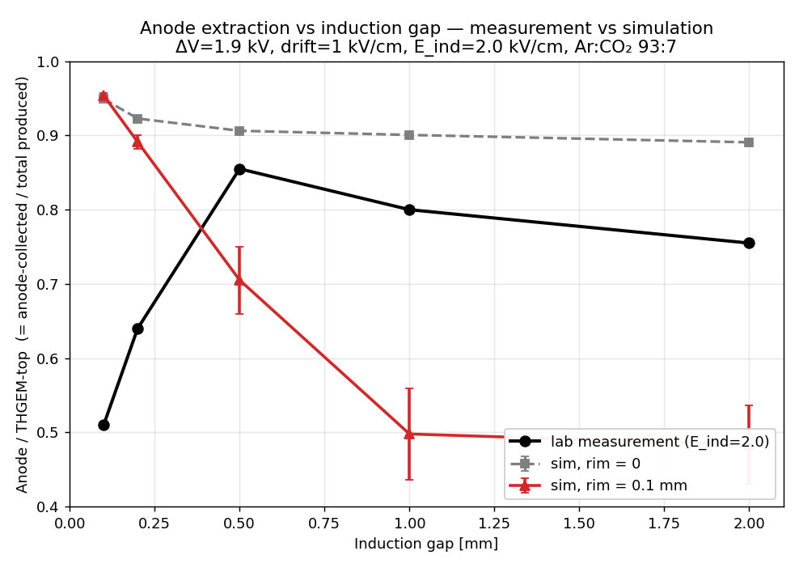
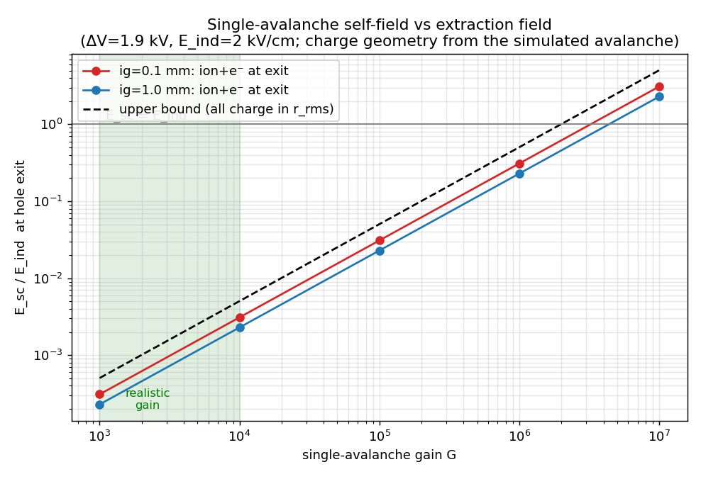

# Investigation: Anode/THGEM-top charge ratio vs induction gap

**Status:** two mechanisms tested and ruled out; the denominator (what "THGEM-top charge"
measures) is the active lead.

This note records an attempt to reproduce, in the Garfield++ THGEM simulation, a lab measurement of
the **Anode/THGEM-top charge ratio as a function of the induction gap**. It documents the two
hypotheses tested so far — static extraction geometry (hole rim + transport-grid resolution) and
single-avalanche space charge — why each was rejected, the `collect_only` tool added along the way,
and the lead now being pursued.

---

## 1. The measurement and the target

The reference data (`charge_ratio.pdf`) were taken at **ΔV_THGEM = 1.9 kV, drift field = 1 kV/cm,
Ar:CO₂ 93:7**, for three induction fields E_ind ∈ {1.5, 2.0, 2.5} kV/cm, sweeping the induction gap
from 0.1 to 2.0 mm. The observable is the **Anode / THGEM-top charge ratio**.

Characteristic shape (E_ind = 2.0 kV/cm):

| induction gap [mm] | 0.1 | 0.2 | 0.5 | 1.0 | 2.0 |
|---|---|---|---|---|---|
| Anode/THGEM-top | 0.51 | 0.64 | **0.855** (peak) | 0.80 | 0.755 |

Two features drive the whole investigation:

1. A **rise to a peak at ~0.5 mm, then a gentle fall** — i.e. the ratio is *lowest at the smallest
   induction gap*.
2. The three E_ind curves **coincide at 0.1 and 0.2 mm** and separate only for gaps ≥ 0.5 mm. So the
   small-gap suppression is **independent of the induction field**.

## 2. The observable in the simulation

Following the interpretation used here, the measurement's denominator ("THGEM-top charge") is taken
to represent the **total avalanche charge**, so the ratio is compared to the simulated
**electron-collection fraction**

```
frac_anode = (electrons collected on the anode) / (total electrons produced in the avalanche)
```

classified from the avalanche electron endpoints (anode / THGEM bottom copper / top copper /
attached), with no induced-signal weighting. At ΔV = 1.9 kV the ions are not drifted (electrons
only), consistent with a collection-fraction observable.

## 3. Study 1 — static extraction geometry (hole rim + transport grid)

**Hypothesis.** The default geometry has no rim (copper flush with the dielectric hole) and a
coarse transport grid, so the simulation *over-extracts*: nearly every avalanche electron reaches
the anode and almost none land on the bottom copper. A real THGEM has the copper etched back from
the hole edge (a ~0.1 mm rim), which should reduce extraction and add bottom-copper collection.

**Tool added — `collect_only` mode** (commit `44cecd1`). The collection fraction classifies
electron *endpoints* and never uses the Shockley–Ramo weighting fields, so a new
`simulation.collect_only` flag (implied by `drift_only`) skips weighting-field sampling, the
read-out electrodes, the induced-signal/charge/amplifier block and the weighting-map dump, keeping
only the transport field, drift area and the collection tally. Field sampling then needs one field
instead of four (**~4× faster**), which makes a finer hole-vicinity transport grid tractable. The
default avalanche path (induced charge) is unchanged.

**Method.** Avalanche collection sweep at ΔV = 1.9 kV, drift = 1 kV/cm, E_ind = 2.0 kV/cm,
Ar:CO₂ 93:7, induction gaps {0.1, 0.2, 0.5, 1.0, 2.0} mm, with **rim = 0.1 mm** and a refined
transport grid (**51 × 161**, ~20 µm lateral — ~5 points across the 100 µm rim). The collection
fraction is cap-independent without space charge, so a modest avalanche cap (500 e⁻) was used.

**Result.**

| induction gap [mm] | 0.1 | 0.2 | 0.5 | 1.0 | 2.0 |
|---|---|---|---|---|---|
| measurement | 0.51 | 0.64 | 0.855 | 0.80 | 0.755 |
| sim, rim = 0 | 0.95 | 0.92 | 0.91 | 0.90 | 0.89 |
| sim, rim = 0.1 mm | 0.95 | 0.89 | 0.71 | 0.50 | 0.48 |
| sim bottom-Cu, rim = 0.1 mm | 0.00 | 0.00 | 0.01 | 0.02 | 0.02 |



**Conclusion.** The rim is a necessary ingredient — rim = 0 is essentially *flat* at ~0.9 (no
induction-gap dependence), and the rim both pulls the magnitude into the measured band and
introduces a slope. But the slope is a **monotonic fall** (0.95 → 0.48), the *opposite* of the
measured rise at small gaps: the simulation is most anode-efficient (0.95) exactly where the
measurement is least (0.51). The ~29–50 % that the rim removes from the anode at large gaps goes to
the **dielectric rim / attachment during the longer induction drift**, not to bottom-copper
collection (which stays ~0–2 % at every gap). A static field — at any grid resolution or rim size —
cannot produce a rise-then-fall, because at fixed E_ind the hole-exit extraction field is
~gap-independent.

## 4. Study 2 — single-avalanche space charge

**Motivation.** The measured rise-to-peak requires a mechanism whose strength *changes with the
induction gap*. Space charge at the real gain is the natural candidate: a dense avalanche confined
near the hole exit could suppress extraction most at small gaps (small volume → high density) and
relax as the gap opens. `AvalancheMicroscopic` has no space charge, so it is absent from the
simulation.

**Key constraint (from the measurement conditions).** The data were taken at a **very low rate,
~10 Hz**. Ion transit is µs–ms, so no ion cloud accumulates between events — any space-charge
effect must be the **self-field of a single avalanche** acting on its own electrons, not a
steady/accumulated cloud.

**Method (Stage 1 estimate).** Rather than a hand-drawn charge blob, the estimate uses the
**simulated avalanche's actual charge geometry** (ionization sites = ion birth positions, and
electron drift-line points, from the rim = 0 sweep), scales the total charge to a real
single-avalanche gain G, and Coulomb-sums the retarding axial field E_sc,z that an electron feels
at the hole exit. It is compared to E_ind = 2 kV/cm. (The avalanche's lateral RMS radius is
~120–130 µm at both 0.1 and 1.0 mm gaps.)

**Result — E_sc / E_ind at the hole exit (ion + electron contributions):**

| gain G | 10³ | 10⁴ | 10⁵ | 10⁶ | 10⁷ |
|---|---|---|---|---|---|
| ig = 0.1 mm | 0.0002 | 0.003 | 0.03 | 0.31 | ~3 |
| ig = 1.0 mm | 0.0002 | 0.002 | 0.02 | 0.23 | ~2 |
| upper bound* | 0.001 | 0.005 | 0.05 | 0.50 | ~5 |

\*all G·e compressed into a sphere of the observed 120 µm column radius — a hard ceiling.



**Verdict — ruled out**, for three independent reasons:

1. **Magnitude.** At this THGEM's realistic single-avalanche gain (10³–10⁴ at ΔV = 1.9 kV, kept
   modest by discharge-safe, low-rate operation), the self-field is **0.02–0.3 % of E_ind** — three
   orders of magnitude too small. Even at an optimistic 10⁵ it is ~2 %, and the hard upper bound
   stays below E_ind until G ≳ 10⁶ (streamer regime).
2. **No gap dependence.** The ions sit in the hole, so the field is essentially identical at 0.1 and
   1.0 mm. The measurement's whole signature is a strong gap dependence.
3. **The real bar is higher.** The hole-exit field also includes the THGEM dipole leakage (≫ E_ind),
   so the field the self-charge must compete with is larger still.

The planned Stage 2 (injecting the self-field into the solver) was skipped: adding a ~1 % field
changes nothing.

## 5. Current lead — the denominator

Both tested mechanisms addressed the **numerator** (anode extraction). But the measurement's own
structure argues against that: the three E_ind curves coincide at small gaps, so the small-gap
suppression is **E_ind-independent** — a signature of the **denominator**, not of extraction losses.

The simulation already computes the induced charges on all three electrodes (anode, THGEM top,
THGEM bottom) via their neBEM weighting fields. From the rim = 0 avalanche sweep (E_ind = 2.0):

| induction gap [mm] | 0.1 | 0.2 | 0.5 | 1.0 | 2.0 |
|---|---|---|---|---|---|
| Q_anode / Q_top | 3.15 | 2.98 | 3.15 | 3.21 | 3.29 |
| Q_anode / (Q_top + Q_bottom) | 1.01 | 1.00 | 1.00 | 1.00 | 1.00 |

The `Anode/(top+bottom) = 1.00` column confirms charge conservation in the induced-signal
computation. But `Anode/THGEM-top` is **flat at ~3.1** — it reproduces neither the magnitude nor the
rise of the measurement. The decisive caveat: those runs had **ion drift off** and a **300 ns
integration window**, so the **ion-induced charge is entirely missing**. Ions drifting up past the
top copper over µs–ms are exactly what should load the THGEM-top denominator, and their contribution
is gap- and time-dependent.

**Next step.** Recompute the denominator with the actual THGEM-top induced charge *including the ion
contribution*: enable ion drift and lengthen the signal integration window to match the
measurement's charge definition (integration/shaping time, electron-only vs. including the ion
tail). Then re-sweep the induction gap and compare `Anode/THGEM-top` to the measurement. The
measurement's charge-readout definition is the key input to settle first.

## 6. Reproducing

Simulation outputs live under `results/` (gitignored):

- `results/transparency_induction_avalanche/` — rim = 0 avalanche induction sweep (also carries the
  avalanche charge geometry used by the space-charge estimate).
- `results/transparency_induction_avalanche_rim100/` — rim = 0.1 mm, grid 51 × 161 sweep.

Figures in this note regenerate from the sweeps via:

```bash
python3 scripts/plot_extraction_comparison.py   # -> docs/figures/extraction_meas_vs_sim.png
python3 scripts/plot_spacecharge_estimate.py    # -> docs/figures/spacecharge_selffield.png (+ table)
```

The `collect_only` mode is in `src/thgem_sim.cc` (commit `44cecd1`).
