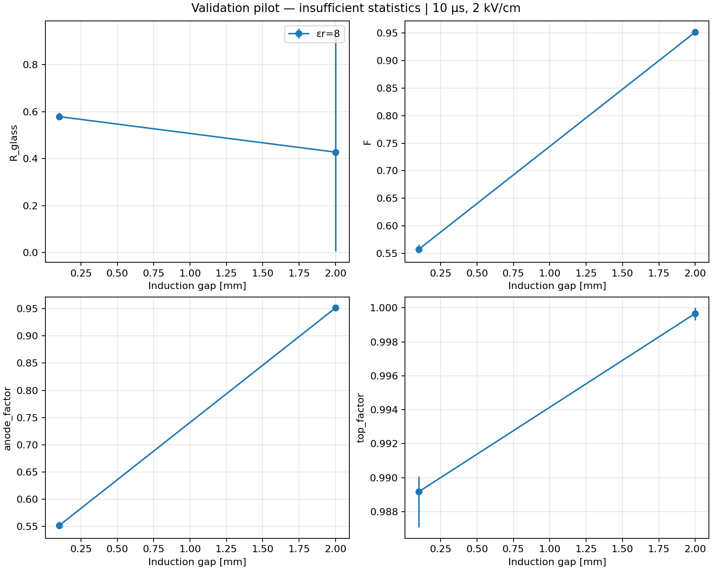

# Contacted-glass signal hypothesis at 10 µs

This diagnostic tests whether the **same transported charge** gives a different
anode/top induced-charge ratio when the collection surface is resistive glass
rather than a metal readout. It does not alter the transport field, gain physics,
charging-up model, or normal simulator behavior. Conclusions can support or
disfavor this signal mechanism in the controlled model; they are not a fit of the
experimental detector.

## Electrical contact and approximation

The 0.8 mm glass rear face is in ideal **ohmic contact over its entire area** with
the readout conductor. There is no intervening gas gap, insulating adhesive,
coupling capacitor, or contact resistance. The physical circuit contains the bulk
glass conductance **in parallel** with its dielectric capacitance, both connected
to the readout conductor. The front surface is not fixed to readout potential in
the short-time weighting calculation.

Transport uses the original metal collection boundary as a settled DC boundary.
Only replay replaces that boundary with glass backed by the contacting conductor.
Each neBEM solve is a separate process; the runner serializes these using a common
`/tmp/thgem-glass-nebem.lock`. Other simulator invocations must not run neBEM
concurrently: older code does not participate in this lock.

For a planar gap d and glass thickness b, the early induced fraction is
`f = d/(d+b/epsilon_r)`. Including the glass bulk conductance gives
`tau = rho * epsilon_0 * (epsilon_r+b/d)` and the normalized transferred charge
after an instantaneous gas traversal is `1-(1-f)*exp(-T/tau)`. This tends to one
at long times. Resistivity must be converted from ohm cm to ohm m.

The diagnostic checks a conservative relative correction using the shortest
planar lateral-mode relaxation scale, `rho*epsilon_0*min(epsilon_r+1,
epsilon_r+b/d)`. The dielectric approximation is accepted only below 1% at the
observation time. This bound is a layered planar check, not a full conductive
THGEM solution. A failed bound means the approximation is insufficient.

Reference: W. Riegler, [Electric fields, weighting fields, signals and charge
diffusion in detectors including resistive materials](https://arxiv.org/pdf/1602.07949),
sections 4.2 and 8.1.

## Run

Use Python with NumPy and Matplotlib. Build normally with the existing ROOT and
Garfield installation. The diagnostic is compiled into `thgem_sim`.

```sh
cmake --build build -j4
python scripts/glass_signal_study.py benchmark
python scripts/glass_signal_study.py contact
python scripts/glass_signal_study.py pilot --out results/glass_signal/pilot
python scripts/glass_signal_study.py sweep --convergence
python scripts/glass_signal_study.py analyse
ctest --test-dir build --output-on-failure
```

The sweep is expensive: it uses the raw neBEM transport field and weighted paths,
32 sampled positive ions and attachment charges per path, and five observation
times. Run the pilot to measure local runtime first. The full study is resumable;
completed stages are reused only for identical executable/configuration/input
hashes. Changing code intentionally invalidates those stage caches.
`status.json` identifies the process, current stage, job directory, and log.
The executable hash is held fixed during a run; rebuilding it causes a controlled
stop rather than mixing replay versions. For a long run, copy the executable
into the ignored study directory and pass that path with `--binary`.

Supply `--gas-source /path/to/gas` if necessary. The production configuration uses
the existing 110-point Ar:CO2 93:7 table. The runner copies gas tables into isolated
job directories and refuses to silently regenerate a missing table. It does not
modify other studies' sidecars, caches, or outputs.

Direct diagnostic interfaces (use one at a time):

```sh
./build/thgem_sim --config config/glass_signal.json --glass-export --out results --run-name snapshot-run
./build/thgem_sim --config config/glass_signal.json --glass-replay results/snapshot-run/charge_snapshots.csv --out results --run-name replay
./build/thgem_sim --config config/glass_signal.json --glass-planar --out results --run-name planar
```

`glass_signal.model` selects `metal` or `glass` for replay.
`glass_thickness_mm` and `glass_epsilon_r` specify the readout geometry;
`sample_times_ns` specifies strictly increasing positive export times.
Replay requires the recorded geometry and field configuration unchanged.
The runner changes only the readout settings between the two replay arms.

## Charge accounting

The new `charge_snapshots.csv` schema contains:

`seed,path,attachment,time_ns,species,charge_e,x_cm,y_cm,z_cm,status`

Its containing directory provides the run identity and complete input config.
Charge is signed in elementary-charge units; coordinates are cm and times ns.
Each path includes the initial electron/positive-ion pair. Deposited dielectric
charge remains at its deposition position. Moving particles are interpolated at
the observation time, rather than replaced by eventual endpoints.

An attachment creates a negative ion at its actual sampled birth position.
`fixed` retains that charge there; `mobile` drifts it using Garfield's fallback to
the positive-ion mobility magnitude with opposite sign. The latter is a
sensitivity model, not an assertion about the actual attached species.

Diagnostic branching uses the same local Townsend/attachment coefficients but
integrates the weight changes exactly for the constant rates on each quadrature
segment. Thus `1 + ionisations = free electrons + attached charge`, including
partial segments for electrons still moving at a sample time. This correction is
confined to the diagnostic; the original simulation path is unchanged. Birth
positions are stratified samples of the corresponding integrated production
measures. Their trajectories are reused across observation times when electron
transport ends before the first observation time.

Failed transport and lateral escapes abort the stage instead of disappearing
from the signal. Incomplete snapshots retain a `.partial` suffix. End-of-time
window charges remain in the snapshot with status `moving`.

For each electrode, replay computes `sum(q * phi_weighting(position,T))`.
The initial pair cancels at the common creation position; multiplying pairs have
zero initial net charge. This is the inventory form of Shockley–Ramo induced
charge. All signed contributions are summed before taking magnitudes. No
avalanche cap or displayed-trajectory subsampling enters the calculation.

Replay evaluates four weighting potentials directly, including the cathode.
It uses full boundary-element evaluations for **all periodic copies**, overriding
the normal transport optimization that approximates distant copies by primitives.
That approximation caused a 2.15% rear-face potential error in the first pilot;
full evaluation reduced it below 0.00006%. The THGEM contact integration test
guards against reintroducing this error. Transport retains its original solver settings.
`signal_charges.csv` contains signed per-path charges; `weighting_checks.json`
records the potential partition residual and the contacted rear-face value.
`transport_ledger.json` records final growth/attachment accounting. The Python
runner records SHA-256 identities of the executable and the shared snapshots.

## Study and interpretation

`config/glass_signal.json` sets 0.8 mm FR4, 0.5 mm holes, 1 mm square pitch,
100 µm rim, 50 µm copper, and 5 mm drift gap. The gap remains measured from the
outer bottom-copper face to the collection surface. This differs from possible
experimental FR4-face gap conventions and does not implement a hexagonal lattice.

Production sweeps gaps 0.1/0.2/0.5/1/2 mm, induction fields 1.5/2/2.5 kV/cm,
and relative permittivities 4/6/8/10/12, without per-gap fits. It starts with 500
paths for each of seeds 501/502 and increases to 1000 then 2000 per seed when a
10 µs paired factor's 95% interval is wider than 0.05. Bootstrap resampling uses
the same path indices in both arms. Ratios use the magnitudes of pooled signed
charges, not averages of individual path ratios.

`--convergence` adds extreme-gap cases at 2 kV/cm with 25 µm target mesh,
5–20 elements, half electron/ion steps, and 64 ion samples. The report requires
changes below 2% in F, attachment sensitivity below 2%, adequate precision,
valid denominator/polarity checks, and potential partition residuals below 1%.

Outputs include `summary.csv`, `glass_comparison.png`, `time_and_charges.png`,
`convergence.json`, `benchmark.json` (benchmark command), and `study.md`.
The charge plots use 227 primaries only as a common 5.9 keV scaling convention.
There is no CSP transfer-function convolution or interpretation as calibrated
DCB209 voltage.

The automated scale comparison uses the existing 2 kV/cm reference ratio
0.51/0.855 at 0.1/0.5 mm. It labels a validated effect sufficient in scale,
partial, or unsupported **within this model**. Missing statistics/convergence,
invalid weighting solutions, or strong attachment sensitivity produce an
inconclusive result. The complete curves and uncertainties must still be checked
before attributing the measured ratio to glass.

## Implementation validation

All four CTest targets pass: the fast physics/accounting tests, 15 planar cases,
the full-contact THGEM integration check, and the pre-existing simulator smoke
test. Planar potential errors are below 0.0011%; field-integral versus endpoint
charge errors are below 0.00024%; growth charge-balance residuals are below
1.4e-15. The largest analytical relative conductive correction bound at 10 µs
in these benchmark cases is 0.46%.

Compact results are committed in `docs/data/glass_planar_validation.json`.
The paired end-to-end validation uses **only two paths per gap**, seed 501,
at 0.1 and 2 mm, 2 kV/cm, and epsilon_r=8. Its snapshots conserve charge to
relative error below 1.6e-15. Both replay arms use the same executable and
snapshot hashes; those identities are in
`docs/data/glass_signal_validation_manifest.json`.

The mobile-attachment pilot gives F approximately 0.558 at 0.1 mm and 0.952 at
2 mm. These values demonstrate functioning paired replay and a possible
gap-dependent response in the controlled model. They **do not establish the
effect's population average, numerical convergence, or agreement with data**.
The pilot's scientific conclusion is **inconclusive**.

See `docs/data/glass_signal_validation_pilot.csv` for both attachment models
and all observation times.


